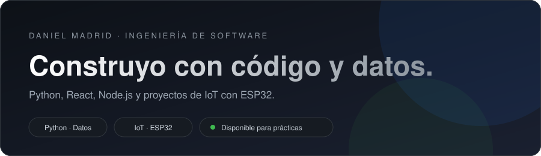

  

  
  

## Sobre mí

Estudiante de 8.º semestre de Ingeniería de Software en la Institución Universitaria Pascual Bravo (Medellín). Me gustan las matemáticas, la programación y el inglés, y los aplico en proyectos de datos, desarrollo web, redes e IoT.

- 🏆 Segundo lugar en concursos de Python, en pareja
- 📖 Aprendiendo: Git, GitHub y más de React y Node.js

## Stack tecnológico

  

| Área | Tecnologías |
|---|---|
| **Lenguajes** | Python · JavaScript · Java |
| **Frontend** | HTML · CSS · React |
| **Backend** | Node.js · Spring Boot |
| **Datos** | Power BI · Excel · Google Colab |
| **IoT y redes** | Arduino IDE · ESP32 · Cisco Packet Tracer |
| **Herramientas** | GitHub · VS Code · Android Studio · VirtualBox (Kali Linux, Ubuntu) |

## Proyectos destacados

### Estación de sensores con ESP32
Mide luz, sonido, temperatura y humedad, y envía los datos a ThingSpeak y Firebase.
[Código](https://github.com/Dmadrid-g/Esp32-sensores)

### Red en Cisco Packet Tracer
7 sedes con enrutamiento estático, DHCP, DNS, correo y web.
[Código](https://github.com/Dmadrid-g/redes-packet-tracer)

### Galería de fotos
App de galería con búsqueda y filtros.
[Código](https://github.com/Dmadrid-g/Intento-de-proyecto-Galeria-fotos)
