  

  
  

## ¡Hola! Soy estudiante de Ingeniería de Software 👋

Estudio 8.º semestre de Ingeniería de Software en la Institución Universitaria Pascual Bravo, en Medellín, Colombia. Me interesa transformar ideas, datos y tecnología en soluciones útiles, combinando el análisis, el desarrollo de software y la experimentación.

### 🛠️ Áreas de interés

- **Análisis de datos:** limpieza, análisis y visualización con Python, Excel y Power BI. Experiencia académica con regresión lineal múltiple y dashboards.
- **Desarrollo de software:** aplicaciones web y móviles con React, Node.js, Spring Boot y Android Studio. Trabajo colaborativo y control de versiones con Git y GitHub.
- **IoT y redes:** prototipos con ESP32 y sensores, integración con ThingSpeak y Firebase, simulación de redes en Cisco Packet Tracer y entornos virtualizados con Kali Linux y Ubuntu en VirtualBox.

### 🏆 Logros y aprendizaje

- Segundo lugar en concursos de Python, participando en equipo.
- Actualmente fortaleciendo mis conocimientos en Git, GitHub, React y Node.js.

### 💡 Mi enfoque

Me apasiona aprender sobre distintas áreas del conocimiento, documentar lo que construyo y desarrollar soluciones prácticas, procurando que sean claras, útiles y fáciles de mantener.

## Stack tecnológico

  

| Área | Tecnologías |
|---|---|
| **Lenguajes** | Python · JavaScript · Java |
| **Frontend** | HTML · CSS · React |
| **Backend** | Node.js · Spring Boot |
| **Datos** | Power BI · Excel · Google Colab |
| **IoT y redes** | Arduino IDE · ESP32 · Cisco Packet Tracer |
| **Herramientas** | GitHub · VS Code · Android Studio · VirtualBox (Kali Linux, Ubuntu) |

## Proyectos destacados

### Estación de sensores con ESP32
Mide luz, sonido, temperatura y humedad, y envía los datos a ThingSpeak y Firebase.
[Código](https://github.com/Dmadrid-g/Esp32-sensores)

### Red en Cisco Packet Tracer
7 sedes con enrutamiento estático, DHCP, DNS, correo y web.
[Código](https://github.com/Dmadrid-g/redes-packet-tracer)

### Galería de fotos
App de galería con búsqueda y filtros.
[Código](https://github.com/Dmadrid-g/Intento-de-proyecto-Galeria-fotos)

  

  
